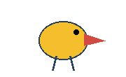

# problem:multiple_choice

## question

Ketika kita makan nasi, tubuh mengubah sebagian kandungan makanan menjadi ....

## option

Plastik

## option

Udara

## option:correct

Energi

## option

Pasir

# problem:multiple_choice

## question

Bagian tubuh yang melindungi paru-paru dan jantung adalah ....

## option

Tulang jari

## option

Tulang tengkorak saja

## option

Tulang kaki

## option:correct

Tulang rusuk

# problem:multiple_choice

## question

Mengapa kita perlu mengunyah makanan dengan baik?

## option

Membuat makanan tidak bisa dicerna

## option:correct

Membantu proses pencernaan

## option

Menghilangkan semua zat gizi

## option

Mengubah makanan menjadi tulang

# problem:multiple_choice

## question

Seseorang dapat membaca tulisan Braille menggunakan ....

## option

Indra pendengaran

## option

Indra penciuman

## option

Indra pengecap

## option:correct

Indra peraba

# problem:multiple_choice

## question

Ketika makan sambil menutup hidung, rasa dan aroma makanan mungkin terasa berbeda. Hal ini terjadi karena ....

## option

Mata membantu mengunyah

## option

Kulit menghasilkan aroma

## option:correct

Indra penciuman ikut membantu mengenali makanan

## option

Telinga menghasilkan rasa

# problem:multiple_choice

## question

Ketika memegang cangkir berisi air panas, kulit membantu kita mengetahui bahwa cangkir tersebut ....

## option

Berwarna

## option:correct

Panas

## option

Berbau

## option

Bersuara

# problem:multiple_choice

## question

Tumbuhan yang hidup di air dan memiliki daun lebar yang mengapung adalah ....

## option

Pinus

## option:correct

Teratai

## option

Padi

## option

Kaktus

# problem:multiple_choice

## question

Mengapa ikan memiliki bentuk tubuh yang membantu mereka bergerak di air?

## option:correct

Agar dapat berenang dengan lebih mudah

## option

Agar dapat terbang

## option

Agar dapat memanjat pohon

## option

Agar dapat berjalan di darat

# problem:multiple_choice

## question

Hewan yang memakan tumbuhan dan hewan lain disebut ....

## option

Pengurai

## option:correct

Omnivora

## option

Karnivora

## option

Herbivora

# problem:multiple_choice

## question

Mengapa burung membuat sarang?

## option

Untuk mencari makan di bawah laut

## option:correct

Sebagai tempat bertelur dan merawat anak

## option

Sebagai tempat menyimpan air hujan saja

## option

Untuk menggantikan sayapnya

# problem:multiple_choice

## question

Mengapa kita perlu makan beragam jenis makanan?

## option

Agar tidak perlu tidur

## option

Agar tubuh hanya mendapatkan gula

## option:correct

Agar tubuh mendapatkan berbagai zat gizi

## option

Agar tidak perlu minum

# problem:multiple_choice

## question

Jika kita bermain di luar lalu terluka, sebaiknya ....

## option:correct

Memberi tahu orang dewasa dan membersihkan luka dengan benar

## option

Menaburkan tanah ke luka

## option

Mengabaikan luka yang kotor

## option

Menggaruk luka terus-menerus

# problem:multiple_choice

## question

Mengapa kita perlu menjaga kebersihan kuku?

## option:correct

Kotoran dan kuman dapat berkumpul di bawah kuku

## option

Agar jari bertambah panjang

## option

Agar kuku bisa mendengar

## option

Agar tangan tidak perlu dicuci

# problem:multiple_choice

## question

Jika banyak pohon ditebang di hutan, hewan yang tinggal di sana dapat ....

## option:correct

Kehilangan tempat tinggal

## option

Mendapatkan rumah lebih banyak

## option

Berubah menjadi tumbuhan

## option

Tidak membutuhkan makanan

# problem:multiple_choice

## question

Tindakan yang paling membantu menghemat energi listrik adalah ....

## option

Membuka kulkas terus-menerus

## option

Membiarkan televisi menyala tanpa ditonton

## option:correct

Mematikan lampu saat tidak digunakan

## option

Menyalakan semua lampu sepanjang hari

# problem:multiple_choice

## question

Mengapa es batu mencair ketika diletakkan di tempat yang hangat?

## option

Karena berubah menjadi batu

## option

Karena kehilangan semua air

## option:correct

Karena menerima panas

## option

Karena terkena angin saja

# problem:multiple_choice

## question

Planet yang memiliki kehidupan dan air dalam bentuk cair di permukaannya adalah ....

## option:correct

Bumi

## option

Neptunus

## option

Merkurius

## option

Mars

# problem:multiple_choice

## question

Bulan disebut satelit alami Bumi karena ....

## option:correct

Mengelilingi Bumi secara alami

## option

Mengelilingi Matahari lebih cepat daripada Bumi

## option

Terbuat dari gas

## option

Menghasilkan cahaya seperti Matahari

# problem:multiple_choice

## question

Planet yang dikenal memiliki warna kemerahan karena permukaannya kaya oksida besi adalah ....

## option

Uranus

## option

Saturnus

## option:correct

Mars

## option

Venus

# problem:multiple_choice

## question

Mengapa kita tidak boleh melihat Matahari secara langsung?

## option

Matahari membuat kita tidak bisa mendengar

## option

Matahari dapat membuat mata berubah warna

## option

Matahari membuat rambut rontok

## option:correct

Cahayanya dapat merusak mata
